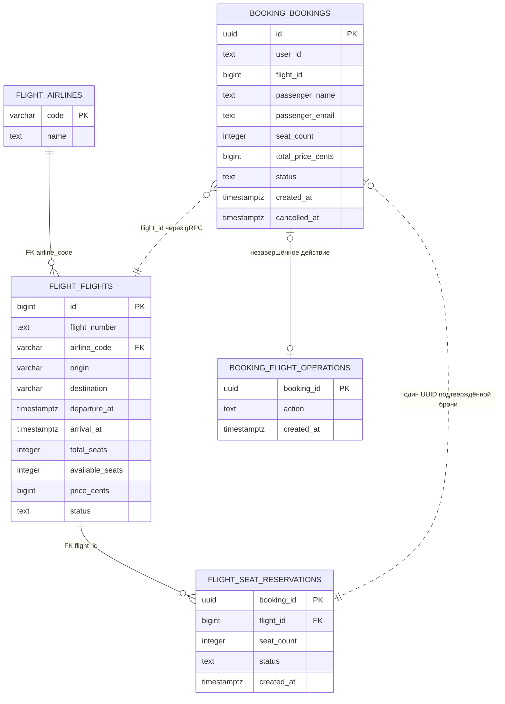

# Схема данных

Booking и Flight владеют отдельными базами. Пунктирные связи на общей диаграмме — передача ID, не внешние ключи между базами.

Префиксы FLIGHT и BOOKING на рисунке показывают владельца, в SQL используются имена без префиксов. Строка резерва появляется перед записью брони, поэтому во время выполнения или компенсации UUID может временно присутствовать только в Flight. Не больше одной резервации на UUID — ограничение PK. Внутри Flight связь с рейсом обеспечивается внешним ключом.

## Почему 3NF

- Все поля атомарны. Пассажиры или места не хранятся списком в одном поле.
- Неключевые поля каждой таблицы описывают одну запись и зависят от её ключа.
- Имя авиакомпании зависит от её кода, поэтому хранится в airlines, а в flights остаётся только ссылка. Дата рейса не дублирует departure_at: уникальный индекс вычисляет день UTC.
- Данные пассажира в брони — сведения для конкретной поездки. У одного user_id могут быть разные пассажиры, поэтому имя и email здесь зависят от брони, а не от user_id.
- Итоговая стоимость — снимок покупки. Она не вычисляется из текущей цены рейса после продажи. Счётчик available_seats обновляется вместе с резервом в одной транзакции.

## Ограничения

- Номер рейса и календарный день UTC уникальны вместе.
- IATA состоит из трёх заглавных латинских букв. Вылет и прилёт в разных аэропортах.
- Время прилёта позже вылета. Цена и общее число мест положительны.
- Доступных мест от 0 до total_seats. В резерве и брони количество положительное.
- Статусы ограничены CHECK. Для отменённой брони обязателен cancelled_at.
