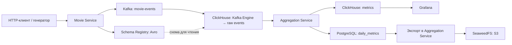

# ДЗ №5 — аналитика онлайн-кинотеатра

Проект реализует **пункты 1–7 задания (9 баллов)**. Два небольших Python-сервиса, Kafka, ClickHouse, PostgreSQL, Grafana и S3-совместимое хранилище SeaweedFS. Пункт 8 с кластером Kafka не реализован: здесь один брокер.

## Запуск

Нужен запущенный Docker Desktop в режиме Linux containers. Python на компьютере устанавливать не нужно. При первом запуске нужен интернет для загрузки образов и пакетов. Для стенда желательно выделить Docker около 6 ГБ памяти.

В PowerShell:

```powershell
cd "C:\3 курс\Архитектура\marketplace-design\hm-5"
docker compose up --build -d
docker compose ps -a
docker compose logs --tail 30 producer migrate aggregation
```

Можно выполнить `docker compose up --build` без `-d`, чтобы видеть логи прямо в терминале. Создание топика, регистрация схемы, миграции, создание бакета и настройка Grafana выполняются автоматически. `migrate` должен завершиться с кодом 0. Остальные сервисы продолжают работать. Генератор сначала создаёт историю за несколько дней, затем отправляет новые события. После его старта подождите 1–2 минуты для заполнения дашборда.

| Что открыть | Адрес | Доступ |
|---|---|---|
| Movie Service, Swagger | http://localhost:8005/docs | без пароля |
| Aggregation Service, Swagger | http://localhost:8006/docs | без пароля |
| Grafana | http://localhost:3005/d/cinema | `admin` / `admin` |
| Файлы S3 в SeaweedFS | http://localhost:9005/buckets/movie-analytics/ | локальный просмотр |
| Schema Registry | http://localhost:8085/subjects | HTTP API |

Порты опубликованы только на localhost. Пароли в Compose — учебные. PostgreSQL, Kafka и ClickHouse доступны внутри сети Docker.

Остановка без удаления данных:

```powershell
docker compose down
```

Повторный запуск сохраняет данные в именованных volumes. `docker compose down -v` удаляет **все данные этого стенда**; используйте только для полного сброса.

## Архитектура



Movie Service отвечает только за проверку и публикацию событий. Aggregation Service отдельно читает данные из ClickHouse, считает метрики, сохраняет их и выполняет экспорт. Между ними нет синхронных вызовов. Общий Docker-образ уменьшает число файлов, но процессы и контейнеры у сервисов разные.

## 1. Топик и схема событий

Схема находится в `schemas/movie-event-v1.avsc`. Она содержит все обязательные поля: UUID события, пользователя, фильм, тип события, время UTC, устройство, сессию и прогресс просмотра. `timestamp` — Avro `timestamp-millis`. Типы событий и устройств — перечисления. Для поиска и лайка прогресс может быть равен 0; фильм всё равно указывается, так как он обязателен по условию.

При старте продюсер создаёт `movie-events` с **3 партициями** и регистрирует схему в Schema Registry, subject `movie-events-value`. Первая регистрация получает версию 1. Повторная регистрация той же схемы не создаёт новую версию. Настроена совместимость `BACKWARD`; при изменении схемы Registry проверяет совместимость. ID и версия выводятся в лог.

Ключ сообщения — `user_id`. События одного пользователя попадают в одну партицию, поэтому Kafka сохраняет порядок их публикации. Это удобно для анализа действий пользователя. Событие, присланное позже, всё равно может иметь более ранний `timestamp`: метрики считаются по времени события.

## 2. Продюсер и генератор

`POST /events` принимает JSON. Pydantic проверяет обязательные поля, UUID, перечисления, часовой пояс и неотрицательный целочисленный прогресс. После этого запись дополнительно проверяется по Avro-схеме и сериализуется в формат Confluent: служебный байт, ID схемы, Avro-данные.

При подтверждённой публикации сервер возвращает **201** и `event_id`. Некорректные данные дают **422**, ошибка доставки после повторов — **503**. Используются `acks=all`, идемпотентный Kafka producer и повторные попытки с увеличением паузы. В логах есть `event_id`, `event_type`, `timestamp`.

В `app/generate.py` реализован режим генератора того же приложения, запущенный отдельным контейнером. Последовательность: начало → пауза → продолжение → завершение → лайк. Часть просмотров не завершается. Также создаются поисковые события. Исторические события имеют стабильные ID, поэтому перезапуск генератора не завышает метрики.

## 3. Приём и хранение в ClickHouse

`events_kafka` использует Kafka Engine и читает Avro через Schema Registry. Materialized View `events_ingest` автоматически переносит записи в `events_raw` с движком `ReplacingMergeTree`.

Партиционирование — по месяцу, сортировка — по дню, пользователю и ID события. Это подходит для дневной аналитики и анализа активности пользователей. Представление `events` читает таблицу с `FINAL`, исключая повторы одинакового события до фонового слияния частей. Событие считается неизменяемым: при повторной отправке того же `event_id` нужно передать прежние поля, включая время и пользователя. Исправление уже отправленного события отдельным API не предусмотрено.

Доставка не объявляется exactly-once: повтор возможен при сбое между записью и подтверждением. Повторы неизменяемых событий убираются при чтении. SQL в `migrations/` применяется контейнером `migrate` автоматически и допускает повторный запуск. Для этой единственной версии схемы достаточно `CREATE IF NOT EXISTS`.

## 4. Интеграционные тесты

Одна команда поднимает необходимые зависимости и запускает тесты:

```powershell
docker compose run --build --rm tests
```

Тесты проходят весь путь **HTTP → Kafka → ClickHouse → PostgreSQL → S3**. Они проверяют поля события, 3 партиции, версию и совместимость Avro, неправильные данные, повтор события, точные значения метрик, повторный пересчёт и экспорт, пустой день, а также подключение Grafana и SQL её панелей.

Для воспроизводимости используются пользователи `e2e-*` и даты 1–9 января 2000 года. Этот диапазон зарезервирован для тестов; их старые записи и агрегаты очищаются автоматически. Обычная история генератора остаётся. Не запускайте два экземпляра теста одновременно. Тест завершается ошибкой при несовпадении ожидаемых значений и печатает `ALL ... CHECKS PASSED` при успехе.

Проверено 25.11.2026: полный запуск Docker Compose и **42 успешные проверки**. Дашборд также проверен в браузере: таблица retention показывает проценты и прочерки для будущих дней.

## 5. Агрегация и PostgreSQL

`app/aggregate.py` работает в отдельном контейнере. По умолчанию каждые **60 секунд** он читает raw-события из ClickHouse и пересчитывает дни с данными. Старые дни пересчитываются тоже: могут прийти запоздавшие события или измениться retention. Для небольшого учебного набора это проще, чем отдельный механизм отслеживания изменений.

Ручной пересчёт: `POST /recalculate/YYYY-MM-DD`. Интервал задаётся переменной `AGG_INTERVAL_SECONDS`:

```powershell
$env:AGG_INTERVAL_SECONDS = "120"
docker compose up -d aggregation
```

| Метрика | Формула и смысл |
|---|---|
| `dau` | `uniqExact(user_id)` по всем событиям за день |
| `avg_watch_seconds` | средний `progress_seconds` у `VIEW_FINISHED`, при отсутствии — 0 |
| `movie_views` | количество `VIEW_FINISHED` каждого фильма за день; рейтинг сортируется по этому числу |
| `conversion` | число завершений / число начал за календарный день; при 0 начал — 0 |
| `cohort_size` | число пользователей, чей первый `VIEW_STARTED` пришёлся на день когорты |
| `retention_d0` … `retention_d7` | уникальные пользователи когорты с любой активностью через N календарных дней / размер когорты |

Даты считаются в UTC. `retention_d1` и `retention_d7` закрывают требование D1/D7, остальные нужны для тепловой карты. Для ещё не наступившего дня значение `NULL`, для прошедшего дня без возвратов — 0. Конверсия является отношением событий за день по условию задания: если просмотр перешёл через полночь, она может быть больше 100%. Это не конверсия по сессиям.

SQL использует `uniqExact`, `avgIf`, `countIf`, `min`, группировки и вычисление разницы дат. Результат сохраняется в `cinema.metrics` в ClickHouse и в `daily_metrics` PostgreSQL. Столбцы: день, название метрики, измерение (например, ID фильма), значение, время вычисления. Значения долей хранятся от 0 до 1; Grafana показывает проценты.

PostgreSQL использует первичный ключ `(day, metric, dimension)` и `ON CONFLICT DO UPDATE`. ClickHouse использует `ReplacingMergeTree(computed_at)` и представление `metrics_current` с `FINAL`. Пересчёт не размножает текущие метрики. Для фильмов сохраняется и нулевое число просмотров, чтобы не оставить старое ненулевое значение.

Одновременные пересчёты сериализованы блокировкой внутри одного процесса. Запись в PostgreSQL выполняется одной транзакцией. Ошибки логируются, есть retry с увеличением паузы. В начале и конце цикла пишутся дата, число обработанных событий, число метрик и длительность. Между двумя БД нет общей транзакции: после сбоя очередной пересчёт приводит их к одному результату.

## 6. Grafana

Datasource и dashboard загружаются из `grafana/provisioning` автоматически. Плагин ClickHouse устанавливается при сборке образа. Все панели читают **готовые агрегаты**, а не raw-события.

Обязательная панель Retention Cohort Heatmap — таблица с цветным фоном ячеек: строки — даты когорт, колонки — Day 0…Day 7, значения — проценты. Будущие дни отображаются прочерком. Дополнительно показаны DAU, конверсия, среднее время просмотра и топ фильмов. Дашборд обновляется каждые 30 секунд и показывает последние 30 дат с агрегатами.

## 7. Экспорт в S3

Вместо MinIO используется разрешённый заданием аналог **SeaweedFS**. Его S3 API доступен приложениям по `http://s3:8333`. Учебные ключи: `cinema` / `cinema-secret`. Бакет `movie-analytics` создаётся автоматически.

Aggregation Service раз в UTC-день выгружает метрики **за вчера** после пересчёта. Проверка расписания идёт с интервалом агрегации. Если PostgreSQL или S3 недоступен, ошибка логируется, выполняются повторы, затем повтор при следующем цикле. После перезапуска экспорт может повториться — это безопасно.

Ручной экспорт: `POST /export/YYYY-MM-DD`. Он читает только PostgreSQL и записывает JSON со всеми метриками за выбранную дату, включая дату и время вычисления. Если данных нет, возвращается 404 — сначала нужен пересчёт.

Путь: `s3://movie-analytics/daily/YYYY-MM-DD/aggregates.json`. Повторный экспорт перезаписывает тот же ключ. Экспортированные дни не обновляются автоматически при каждом позднем событии: для обновления старого файла нужно вызвать ручной экспорт.

## Файлы проекта

| Файл или папка | Назначение |
|---|---|
| `compose.yaml`, `Dockerfile`, `requirements.txt` | запуск и зависимости |
| `schemas/` | версия Avro-схемы |
| `app/producer.py` | HTTP API, схема, публикация в Kafka |
| `app/generate.py` | синтетические события |
| `app/aggregate.py` | SQL метрик, расписание, PostgreSQL и экспорт |
| `app/common.py` | подключения и повторные попытки |
| `app/migrate.py`, `migrations/` | автоматическое создание таблиц и бакета |
| `grafana/` | плагин, datasource и dashboard |
| `s3/config.json` | локальные ключи SeaweedFS |
| `tests/e2e.py` | проверки всей цепочки |
| `DEFENSE.md` | короткая демонстрация с командами |

## Ограничения решения

Это учебный стенд: один Kafka-брокер, replication factor 1, один процесс агрегации, без пользовательской авторизации и без production-настроек безопасности. Данные сохраняются на диске, но кластерной отказоустойчивости нет. Это осознанная граница решения на 9 баллов. Для большого объёма нужны инкрементальные расчёты, масштабирование и отдельная политика очистки истории.

## Документация технологий

- [ClickHouse: AvroConfluent и Schema Registry](https://clickhouse.com/docs/interfaces/formats/AvroConfluent)
- [Grafana: настройка ClickHouse datasource](https://grafana.com/docs/plugins/grafana-clickhouse-datasource/latest/configure/)
- [SeaweedFS: S3-совместимое хранилище](https://github.com/seaweedfs/seaweedfs)
